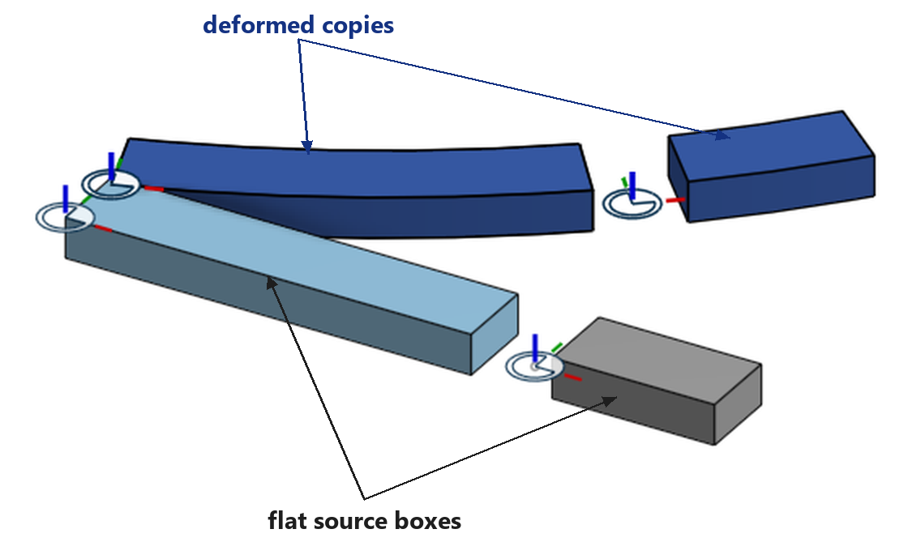
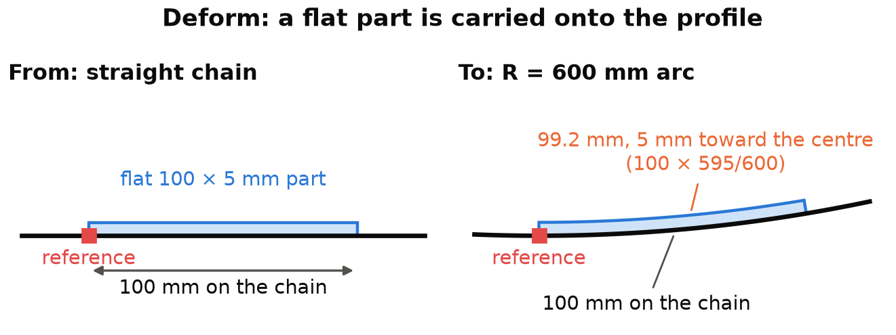
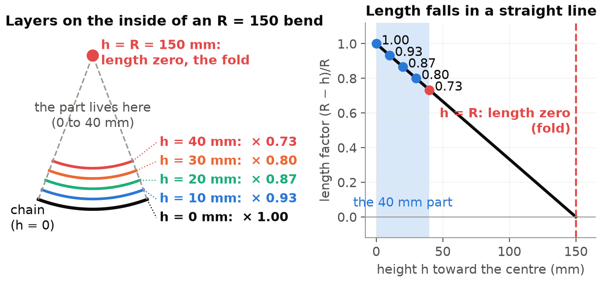
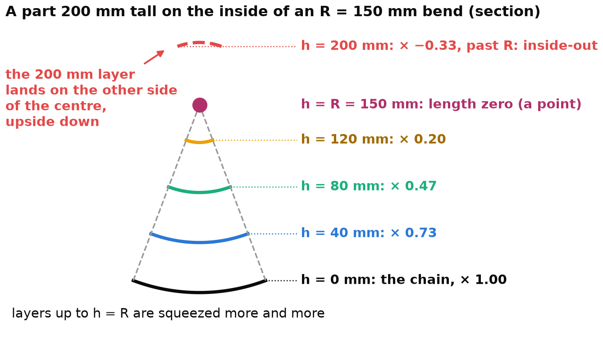
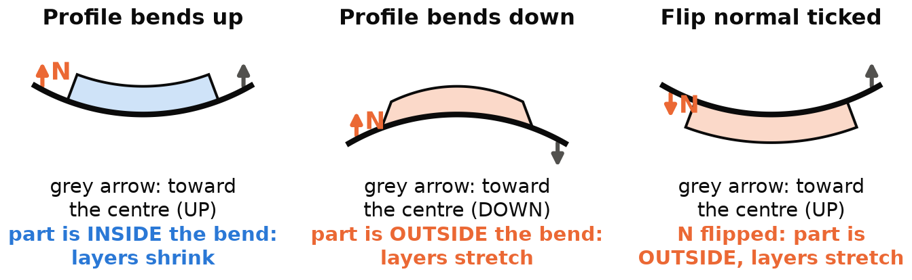
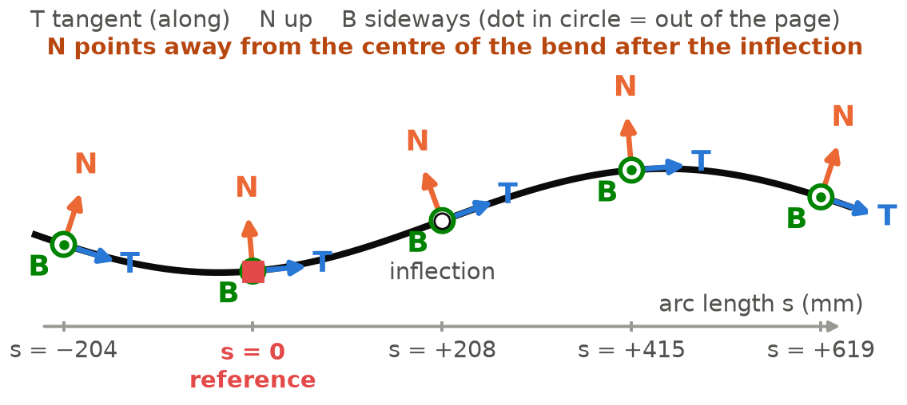
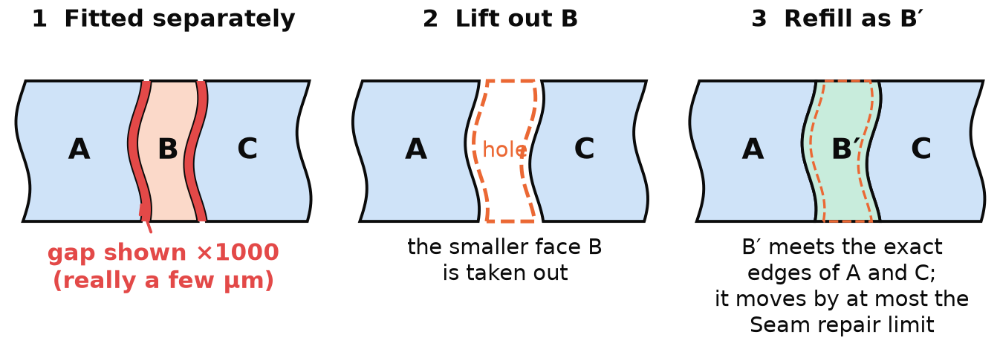
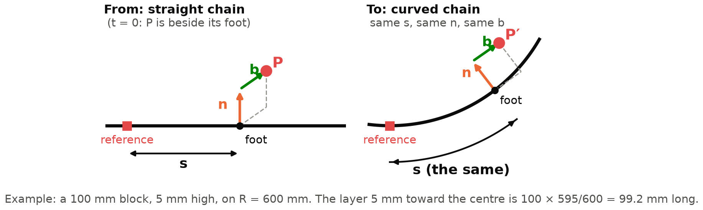
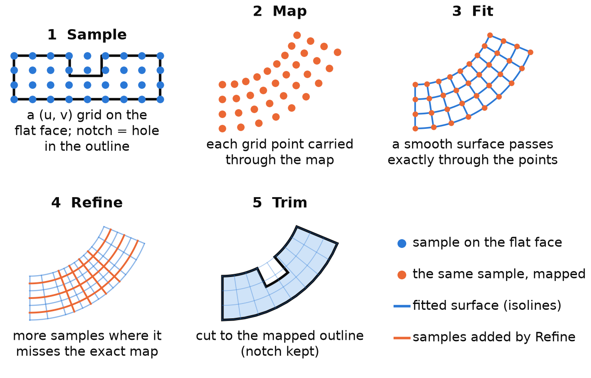

# Deform, explained

*For designers who use the Deform feature (Onshape document **curveMapping_public**, tab `deform`). Written 2026-11-10 against engine V33.
Statements were checked against the code (`curveMappingCore.fs`, `deform.fs`, `canonical_edges.fs`) or measured on real models.*

**What you will take away:** how to predict where each part of your geometry goes, what Deform keeps exactly and what it changes, how accurate the result is,
what each message means, and, for the curious, how it works underneath. Terms marked † are explained in the glossary on page 10 ("Under the hood").

---

# 1. What Deform does

You model a part flat (an insert, a core, a tip protector, a graphic) and Deform puts it on the curved profile (rocker, camber, tips) the way a
real layer would bend. You give it two chains of edges, a **From** chain (where the part is drawn, usually straight) and a **To** chain (where it must end up),
and a reference point on each. Every point of the part is carried from the From chain to the To chain.

## Four rules to predict the result

1. **Distance along the chain is kept.** A point 1500 mm along the From chain (measured from its reference point) lands 1500 mm along the To chain.
2. **Height and width are kept.** A point 5 mm above the From chain lands 5 mm above the To chain, measured straight out from it.
3. **Layers stretch or shrink like real layers.** The inside of a bend is the side the centre of the circle is on. A layer at height h toward the centre of a bend of radius R is (R − h)/R as long;
   a layer at height h on the outside is (R + h)/R as long.
4. **Faces square to the chain stay flat; faces parallel to it curve with it** (table below).

## Worked examples

- **A 100 mm long, 5 mm thick block on a bend of R = 600 mm.** The side on the chain stays 100 mm. The side 5 mm toward the centre is
  100 × 595/600 = **99.2 mm**; on the outside of the bend, 5 mm away from the centre, it would be 100 × 605/600 = **100.8 mm**.
- **A 100 mm long part, 40 mm tall, standing on the inside of an R = 150 mm bend (its top 40 mm toward the centre).** The layer 30 mm toward the centre is 100 × 120/150 = **80 mm** (it loses 20%).
  The top layer, 40 mm toward the centre, is 100 × 110/150 = **73 mm**. Nothing is wrong yet, but the part is being squeezed hard. A layer at 150 mm (the radius) would have zero length.
- **A part taller than the radius** (for example 200 mm on R = 150 mm) **folds.**

  Layers past the radius are mapped through the centre of the circle: the length factor (R − h)/R goes negative (at 200 mm it is −0.33), so the top of the part comes out inside-out on the wrong side of the bend and the surface turns over on itself.
  Deform does not warn you. Keep every height smaller than the tightest radius on the inside of the bend.

## What happens to each kind of face (planar chains)

| Face of your flat part | After Deform |
|---|---|
| End faces (square across the chain) | Stay flat: true planes |
| Side faces (parallel to the plane the chain bends in) | Stay flat: true planes |
| Top and bottom faces (parallel to the chain) | Curve with the chain: freeform surfaces (not cylinders), unless the To chain is straight there, in which case they stay planes |
| Any other angled or curved face | Freeform surface |

The feature reports how many faces it kept as planes. If your chain twists in 3D, side and end faces may curve too.

---

# 2. Using Deform

1. **Source bodies:** the bodies to deform (or Faces mode for selected faces). Each body becomes its own result; the source stays.
2. **From edge(s) and From reference:** the chain the part is drawn against, and a point on it (a vertex, a mate connector or a plane; for a plane the plane's origin is projected onto the chain).
3. **To edge(s) and To reference:** the profile the part goes on, and the matching point.
4. **Check the side.** If the result comes out upside-down (on the wrong side of the profile), turn on **Flip normal**. If it runs the wrong way along the
   profile, turn on **Flip** (the arrow beside To edge(s)).
5. **Choose the frame orientation** (below), then check the result and the messages.

## Frame orientation: one rule

**If both chains lie in one plane (a ski profile drawn in a side view), choose Binormal. Otherwise leave it on Frenet.**

- **Binormal:** you pick a direction square to that plane (a face, a mate connector or a world axis). "Up" is then fixed in the plane along the whole chain. Both chains must lie in a plane square to that same direction; it cannot be used on chains that wander in 3D.
- **Frenet (default):** "up" is worked out from the chain's own curvature: it starts at the first edge that is not a straight line, pointing toward the centre of that bend, and is carried along with the smallest possible turn.
  So it never flips suddenly, but after an inflection† (where the bend changes direction) it points away from the centre of the new bend. In Frenet mode a straight chain takes its "up" from the other chain.
  If the part ends up on the wrong side, use **Flip normal**; Flip normal turns the To frame over, it cannot repair an arbitrary twist.

---

# 3. What changes in your geometry

| Always kept | Changed |
|---|---|
| Distance along the reference chain | Lengths at other heights (rule 3) |
| Height and width offsets from the chain | Angles between lines that are neither along nor across the chain |
| Whether a face stays on the same side of the chain | Areas |
| Mate connectors you pass in (they move with their body) | Face count: it can drop (tiny faces are absorbed) and sometimes rise |

## Is it accurate enough?

| What | How far from the exact map | Where it comes from |
|---|---|---|
| Edges | aims for 0.5 µm (micrometres; a hair is about 70 µm thick) | Edge accuracy; checked at 16 points per edge, the last fit is accepted |
| Faces | aims for 2 µm | Mapped surface accuracy; checked at probe lines, up to five refinements |
| Faces next to an absorbed tiny face | up to the tiny face's width | Tiny faces are absorbed (section 6) |
| A refilled face (seam repair) | up to the **Seam repair limit**: 50 µm (0.05 mm) by default | Section 6 |
| Filled faces (Fill, holes) | not checked, except by Face accuracy on up to four thin faces | Section 4 |

**Decision rule.** Compare your part's tolerance with the largest shift you will accept. With the default limit, an unusual face can be off the exact map by up to 0.05 mm where it was refilled. If a face has a tolerance
tighter than that, leave the Seam repair limit at its default, read the repair message ("the largest shift of a face was X µm"), and inspect that face. The rest of the part is within a few µm.

---

# 4. The inputs

Main inputs. The sampling, degree and accuracy settings are in the appendix of "Under the hood" (page 11).

| Input | What it does | Default and advice |
|---|---|---|
| **Source bodies** (or **Faces** mode) | What to deform. Each body becomes its own result. | In Faces mode every face is filled: no planes, no absorbed tiny faces. |
| **Mate connectors to deform** | Moved through the same map. | A connector on a source body goes onto its result. |
| **From edge(s), From reference** | The chain the part is drawn against, and a point on it. | The chain must be connected edges. |
| **To edge(s), To reference, Flip, Flip normal** | The profile the part must go on. | |
| **Frame orientation** | Frenet or Binormal (section 2). | Binormal for planar chains, otherwise Frenet. |
| **Seam repair limit** | The largest gap that is repaired and the largest shift of a refilled face. 0 turns the repair off. | 50 µm (maximum 200 µm). See section 6. |
| **Name suffix** | Appended to each result's name. | " (deformed)". |
| **Keep wires** | Keep the mapped edges as wire bodies. | Off. |

---

# 5. What you get back

- **A new body per source body.** The source stays. A solid is closed back into a solid where possible.
- **Planar faces are real planes.** The feature reports how many ("11 face(s) map onto a plane and were built as planes").
- **Fewer faces than you put in, sometimes.** Tiny faces and tiny edges are absorbed: a real ski surface went from 78 to 75 faces and a 193-face lid to 185.
- **New face identities near repaired seams.** A face that was refilled is a new face. A saved selection that pointed at it (Move face, Mutual trim, Enclose) may
  report "1 missing selection". Re-pick that selection from the model.

## Messages and what to do

| You see | It means | What to do |
|---|---|---|
| "N face(s) map onto a plane and were built as planes" | Flat faces stayed planar. | Nothing. |
| "N tiny face(s) of the source could not be rebuilt; their place is covered by the neighbouring faces" | A face could not be rebuilt, but built faces lie within 20 µm of it, so the result has no hole. Absorbed tiny faces give no message. | Check the result looks right. |
| "Seam repair: n of m unsewn seams were closed (the largest shift of a face was X µm)" | The repair ran. | Check the shift is acceptable for that face (section 6). |
| "N seam(s) up to X µm wide are wider than the Seam repair limit … set the limit to at least Y µm" | Seams wider than the limit were counted but not repaired. Y is X plus 10%: a suggestion, not a guarantee, and it can exceed the 200 µm maximum. Only seams under 300 µm are counted. | Raise the limit only if the face that would move is not a sealing, mating or datum surface. |
| "N seam(s) of the result are not sewn" | Seams the repair could not close. | An Enclose, Thicken or offset may fail there. |
| "The result has N separate sheets" | The faces joined into one main body, but N small pieces would not sew to it. | Raise Maximum control points; check for a missing face. |
| "N face(s) … could not be rebuilt and are missing" | A face could not be rebuilt, for example a whole sphere (a face with no edges). | Split it into faces that have edges, for example two hemispheres. |
| "The rebuilt faces … are left as separate sheets" | The rebuilt faces would not join into one body at all. | Raise Maximum control points; this usually fixes it. |

The "planes" and "tiny face" notes appear only when no face is missing.

---

# 6. Seams: why they happen and what the limit does

Deform rebuilds each face separately. Each is fitted to within about 2 µm of the exact map, so two neighbouring faces can end up a few micrometres apart.
The geometry kernel† only joins edges that are within about one micrometre. Most gaps measured on real models are 1 to 15 µm; a few, next to tiny faces or clusters
of tiny edges, reach 50 to 120 µm. A pair of edges that sit side by side without being joined is an **unsewn seam**†: a later Enclose, Thicken or offset
can fail there.

Deform closes a seam by **refilling the smaller of the two faces**: the face is taken out, a new face is built that is bounded by the *exact* edges of its neighbours
(so it meets them), and the new face is joined. It is kept only if, at five test points, it stays within the **Seam repair limit** of the face it replaced, and if
it joins: it ends with fewer free edges† than the face it replaced. If not, the original face goes back (or is re-joined as it was).

Tiny faces are handled before that: a four-sided face under 0.05 mm² is not built at all (only with Map every face, in Bodies mode). Its two long edges share one mapped edge and the face on the other side of it is adjusted to meet that edge.

**How to choose the limit.** Leave it at 50 µm (0.05 mm). Raise it only if the feature reports seams wider than 50 µm and the faces that would move are
not sealing, mating or datum faces. Up to 40 repair attempts are made per body.

| Model | Source | Deformed | Seams |
|---|---|---|---|
| Ski top surface | 78 faces, 30 free edges | 75 faces, 30 free edges | closed by adjusting the faces next to absorbed tiny faces |
| 193-face lid | 193 faces, 54 free edges | 185 faces, 54 free edges | the widest seam, 114 µm, needed a limit of 150 µm: the refilled face's edge moved by up to 114 µm, changing that 172 mm² face's area by 0.55 mm² (0.3%) |

A watertight deformation has exactly the source's free edges: its own outer boundary.

---

# 7. Limits and troubleshooting

- **Big bodies.** Deform spends interpreter steps on every mapped point. A feature shares about 24,000 mapped points between its bodies, and every face gets at least 110 of them. A face that does not fit gets a coarser grid or is filled,
  and a very large body can stop with "Too many steps". Deform fewer bodies per feature or raise Mapped surface accuracy.
- **Thick parts on tight bends.** See the worked examples: a part taller than the radius folds.
- **Faces with no edges** (a full sphere, a closed face with no vertices) cannot be rebuilt.
- **Edges shorter than 10 µm** are dropped from outlines and their end points merged, so a face made of such edges can disappear into its neighbours.
- **A tiny face** is any four-sided face under 0.05 mm². A small square face qualifies, and its neighbours then move by its width.
- **Upside-down result.** Use Flip normal.
- **Frenet on chains that wander in 3D.** "Up" is chosen once for each chain, at its first edge that is not a straight line. If the part comes out on the wrong side, try Flip normal.

---

# Under the hood

## Glossary

- **Arc length:** distance travelled along a chain from its reference point.
- **Frame:** three directions at a point of a chain: along (T), up (N) and sideways (B).
- **Inflection:** a point where a curve changes from bending one way to bending the other.
- **B-spline / control points:** a smooth curve or surface defined by a net of control points.
- **Tiny face (sliver):** a four-sided face under 0.05 mm².
- **Free edge:** an edge with a face on only one side (the model's outer boundary).
- **Sewn / unsewn seam:** whether the kernel has joined two edges into one; an unsewn seam is two faces that meet within micrometres but are not joined.
- **Pin:** a point where a face's surface is forced onto a shared edge.
- **Kernel:** the geometry engine inside Onshape.

## How a point moves

For a point P of your part:

1. Find the closest point on the From chain; call its arc length s.
2. Measure P in the frame there: how far along (t, zero for points beside the chain), how far up (n), how far sideways (b).
3. Go to arc length s' = s + (To reference arc − From reference arc) on the To chain.
4. Put the point at the same offsets in the To frame there.

In symbols, with O(s) the chain point at arc length s and (T, N, B) its frame:

$$ s' = s_{To,ref} + (s - s_{From,ref}), \qquad P' = O_{To}(s') + n\,N_{To}(s') + b\,B_{To}(s') + t\,T_{To}(s') $$

**Reading it:** measure how far along the From chain a point is and how far it sits up and to each side; put it the same distance along the To chain and the same distance up and to each side.

Each chain is measured at 100 points per curved edge, and between them it is a smooth curve; beyond either end it continues along the end's own circle.
An edge of any shape that lies wholly within one straight edge of the From chain and one straight edge of the To chain is simply moved as a rigid copy.

**Why layers change length.** A layer at height h above a chain with curvature κ (one over the radius) has a length factor 1 − hκ per unit of reference length, with h counted toward the centre.
From a straight chain onto a circle of radius R that is (R − h)/R. From a curved chain onto another curved chain it is (1 − hκTo) / (1 − hκFrom). The factor reaches zero at h = 1/κ: that is the fold.

## What Deform does to the pieces

Deform builds the result in this order: **vertices, edges, faces, join, seam repair.**

**Vertices and edges.** Every vertex is mapped once; vertices that land within 10 µm are merged. Every unique edge is mapped once: sample points are mapped exactly (at least 10, or the multiplier times the
edge's control-point count) and a smooth curve of the chosen degree is fitted through them, with its ends forced onto the mapped vertices. Deform then checks the curve
against 16 extra exactly-mapped points. If the worst miss is larger than the **Edge accuracy** it refits with more samples and more control points (up to three fits in all; the control-point limit doubles each time, up to 200);
it accepts the last fit without a warning.

**Faces.** Each face is mapped on its own.

1. **Sample** the face on a (u, v) grid: its own control-net size, but at least 5 samples in each direction (12 by 8 on faces larger than about 44 by 28 mm).
2. **Map** every grid point through the map above.
3. **Fit** a smooth bicubic surface exactly through the mapped points.
4. **Refine** at a limited set of probe lines and cell centres: any direction that misses the **Mapped surface accuracy** gets twice as many samples, up to five times.
5. **Trim** the surface to the mapped outline of the face.

A face whose mapped boundary and up to 25 interior points are coplanar within 2 µm is built as a true plane instead (in Fill mode too). Faces with holes, outlines that wrap around, or no room in the point
budget are filled from their outline (a fill follows the outline only, so it loses the face's exact shape). Neighbouring mapped faces are fitted separately: they meet at the same mapped vertices, but they do not share one edge curve, which is why seams appear.

**Tiny faces.** A four-sided face under 0.05 mm² is not built (only with Map every face, in Bodies mode). Its two long edges share one mapped edge, and the face across the second long edge is *pinned* to it: its surface is adjusted by the smallest possible change of
its control points so that it passes through points on the shared edge. A pin that would move a control point by more than 0.1 mm is rejected.

## Advanced inputs (Setup)

| Input | What it does | Default and advice |
|---|---|---|
| **Source sampling mode, Source CP multiplier** | How densely each source edge is sampled (control point-based: samples per control point; length-based: one per given length). | Control point-based, 3. Raise it for edges with fine detail. |
| **Target degree, Keep source degree, Maximum control points** | The type and size of the fitted curves. | 3, off, 15. If you see "left as separate sheets", raise the maximum. |
| **Tolerance** | The accuracy each curve fit stops at. Edge accuracy is stricter and is what governs the result. | 0.01 mm. Leave it. |
| **Edge accuracy** | How closely each mapped edge follows the exact map (checked at 16 extra points per edge). | 0.5 µm. Values below 0.5 µm are raised to 0.5 µm with Map every face. |
| **Face accuracy** | Checks long thin faces that were filled (at most four per body). | 0 (off). |
| **Face builder** | "Map the surface of every face (test)" (default), "Map the surface of long thin faces" (at most 6 faces), or "Fill (from the wrapped outline)". | Map every face. |
| **Mapped surface accuracy** | How closely a mapped face follows the exact map between its samples. | 2 µm. A coarser value is faster. |
| **Debug** | Show the stages and frames. | Off. |

## The math, in one place

1. **Map.** s' and P' as above. The foot s of P on the From chain solves (P − O(s)) · T(s) = 0.
2. **Layer length.** Factor 1 − hκ(s); straight to circle: (R − h)/R; curved to curved: (1 − hκTo)/(1 − hκFrom); folds where hκ = 1. *Reading it: the tighter the bend and the higher the layer, the more it is squeezed.*
3. **Surface fit.** With cubic basis functions Ni and the grid parameters uk, vl, form the matrices Aki = Ni(uk) and Blj = Nj(vl). The control net P
   solves A P BT = Q, where Q holds the mapped grid points: P = A−1 Q B−T. *Reading it: choose the control points so the surface passes exactly through every moved sample.*
4. **Pin.** For K pins let A be the K × N matrix of basis weights at the pin parameters and r the miss at each pin. The change Δ = AT (A AT + λI)−1 r (λ = 10−7)
   is the smallest control-point change (with a small stabilising term) that makes the surface meet the pins. *Reading it: nudge the surface as little as possible so it touches the shared edge.*
5. **Seam.** Two free edges form a seam when their middles are closer than the Seam repair limit, their lengths agree within 10%, and they are longer than 30 µm. *Reading it: two edges side by side, about the same length, closer than you allowed.*
6. **Refill test.** Keep the refilled face F′ if, at five test points of the old face F, the distance to F′ is at most the limit, and F′ ends with fewer free edges than F. *Reading it: keep the new face only if it barely moved and it actually joins.*
